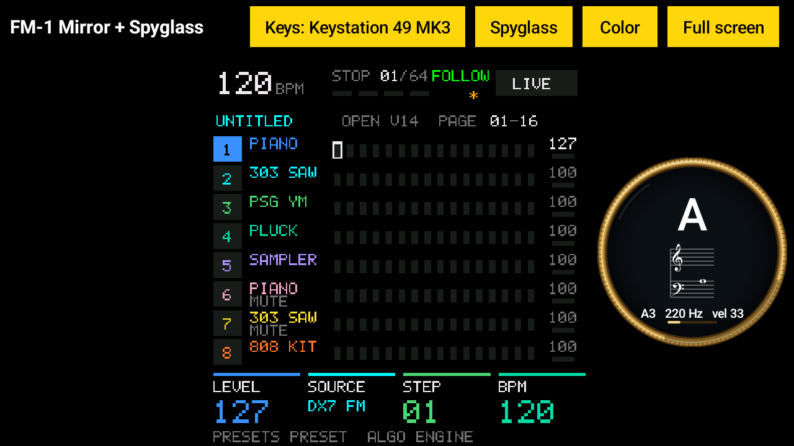

# FM-1 Big Screen + Spyglass for Android

*Formerly called FM-1 Mirror: same app, new name.*

☕ If this helps you make music, you can [buy me a coffee on Ko-fi](https://ko-fi.com/aikellogg).

The M-VAVE FM-1's tiny 1.54-inch screen, **big on an Android tablet or phone**, live, over USB or
**Bluetooth**. Play the FM-1 from a USB keyboard through the same app, and watch every note or chord
you play, on the keyboard or on the FM-1's own keys, in a **spyglass** beside the screen. And from 1.6.8, a built-in
**Mellotron** (flute, strings, choir) that the FM-1's own keys play, out of the tablet.



It combines two free apps for Android: [FM-1 Big Screen](https://github.com/pfkellogg/fm1-mirror) (the
big screen) and [Synth Spyglass](https://github.com/pfkellogg/synth-spyglass-android) (the notes). On
Android only one app at a time can play the FM-1, so the two can't run together; this one does both.

**Watch it:** [FM-1 Mirror + Spyglass for Android: Big Screen, MIDI Bridge & Note Spyglass, All in One](https://youtu.be/XDqrabQf5uY) (2:03), and what's new: [FM-1 Mirror's Big Update: Smooth, a Floating Spyglass, and Melodee on a Big Screen](https://youtu.be/Cve21r8oZJs) (on the Mac, but the Android app has the same Smooth, bigger staff, hide-mirror and firmware name).

Questions, or something not working? Write to me: **pfkellogg@gmail.com**

**No FM-1?** [MIDI Spyglass](https://github.com/pfkellogg/midi-spyglass) is the spyglass on its own, for any MIDI keyboard: the notes and chords, the staff, the waveform, and FROM → TO pairs that play your synths (Mac, Windows, Linux and Android; [video](https://youtu.be/GMLf3W4oTp4)).

## What's new about it

The FM-1 doesn't normally share its screen with anything. What I added is a small piece of intelligence inside its
firmware: **the FM-1 sends its display only when my app asks for it.** About once a second the app says "I'm watching";
while it does, the FM-1 sends each part of the screen it redraws, and when the app goes quiet the FM-1 stops. With no app
asking it sends nothing, and it plays exactly as before.

That's why the firmware matters: the regular releases of SLOOP, JIANT, Melodee and the others don't have this part, so
there's nothing to show. Their **Big Screen** versions are the same firmwares with this one small addition (free, MIT
licensed, so any firmware author can include it; it's offered to M-VAVE, SLOOP, Erik37 and NACHTFAHRT).

On the other end, my app catches the screen and makes it readable: as big as you like, smoothed and sharpened, in
high-contrast colours if you want, with the spyglass for notes and chords beside it. FM-1 Big Screen runs on Mac, Windows,
Linux and Android, and iPhone and iPad are coming.

## Download

**Two versions: Basic and Max.** From 1.6.11. Pick one; either can be swapped for the other later (it installs over it).

| Version | What's in it | File | Size |
|---|---|---|---|
| **Max (with Mellotrons)** | Everything, with a Mellotron's **flute, strings and choir built in**, ready to play from the FM-1's keys | [**FM-1-Mirror-Spyglass-android.apk**](https://github.com/pfkellogg/fm1-mirror-spyglass-android/releases/latest/download/FM-1-Mirror-Spyglass-android.apk) | about 32 MB |
| **Basic** | Bare bones: the big screen, the spyglass and the built-in piano. Mellotron sounds (and every new one we make) download only if you want them | [**FM-1-Mirror-Spyglass-android-lite.apk**](https://github.com/pfkellogg/fm1-mirror-spyglass-android/releases/latest/download/FM-1-Mirror-Spyglass-android-lite.apk) | about 3.4 MB |

In the files, Basic is the one ending in **-lite**.

(Android 7.1 or newer: tablets, phones, and from 1.5.0 a **Fire TV Stick 4K**, see [On a TV](#on-a-tv-fire-tv-stick-4k))

**Mellotron sounds, in both versions:** long-press the **Mellotron** button (on a TV, long-press OK on it), or in Basic
just tap it, for the list of sounds online, and tap one to download it (flute 7.8 MB, strings 9.5 MB, choir 8.9 MB; a
downloaded sound can be removed there too). New sounds are added to that list (sounds/sounds.json in this repo), so
they arrive without an app update. The app goes online only for that list and those downloads.

Open the link on the tablet or phone and tap the file when it has downloaded. It isn't from Google
Play, so Android asks first: allow your browser to **install unknown apps**, then tap **Install**.

> **Not the green "Code" button.** GitHub's green **Code → Download ZIP** gives the app's source
> code, which doesn't install. Use the link above, or **Releases** on the right of the page.

Already have FM-1 Big Screen for Android? This installs over it, as an update.

## Plugging it in

The tablet's USB-C port takes a small **USB hub**. Into the hub:

- the **M-VAVE FM-1**, with its USB cable
- the **keyboard** (any USB MIDI keyboard), or a USB MIDI interface whose MIDI IN comes from another
  instrument or a sequencer

The FM-1's sound still comes out of its own headphone jack, as always.

**A plain hub, without its own power, is the safe choice.** Many tablets can either charge or run a hub,
not both at once: a hub that sends power into the tablet can leave it charging and seeing nothing (tested
2026-11-14 on a K6m tablet). The tablet then powers the hub; the FM-1 runs on its own battery and a small
keyboard takes little, but the tablet doesn't charge while you play. If you try a hub with a power input,
plug the hub into the tablet first and its power in after.

**Nothing shows up, not even the FM-1 plugged straight in?** Restart the tablet with the FM-1 plugged in:
its USB port can get stuck after a hub that charged it.

## The FM-1's screen: one-time setup

The FM-1 doesn't normally send its screen anywhere, so it needs the **FM-1 Big Screen** firmware: M-VAVE's
free Official Open firmware plus one small addition that sends the screen over the USB cable. Open the
app with the FM-1 plugged in and it tells you which firmware the FM-1 has and what to do. With the
firmware it came with, it's two steps:

1. **M-VAVE's Official Open firmware**, from M-VAVE's
   [FM1 Workbench](https://open.m-vave.com/fm1-workbench) page in Chrome (a computer is easiest):
   **Device update › Recovery & force update**, tick **Force flash**, **Connect device**, tick
   **I have backed up…**, **Force flash**. This replaces the FM-1's sounds with M-VAVE's: if you made
   your own, save them first on the page's **Projects & sounds** tab.
2. Plug the FM-1 back into the tablet: the app offers **Install Big Screen** (about 2 minutes). Keep the
   FM-1 plugged in and on until it's done.

**Coming from M-VAVE's V16:** the FM-1 keeps V16's updater, which names itself `ota-FM-1_016`. This app finds it
from 1.4.0; **older versions looked only for V15's updater**, said the connection was lost partway through the
install, and left the FM-1 waiting in its updater (M-Upgrade or M-VAVE's page finishes it). With an older version,
put the original V15 back first (**Recovery & force update › Restore original V15**). Thanks to a viewer who
reported it.

Tested with FM-1 Big Screen 1.3.0 on a Mac, on a real FM-1 that had been on V16 (2026-11-04): V16, then Official Open, then Big Screen, with no lost connection. Not yet tested from V16 on Android. Installing Big Screen replaces V16. [The results](https://github.com/pfkellogg/fm1-mirror/blob/master/docs/V16-TEST.md), and [the video](https://youtu.be/WOjvFdw5KMA).

Going back is easy: on the same page, **Device update › Start update** puts back M-VAVE's own Official
Open firmware, and **Recovery & force update › Restore original V15** the firmware it came with.

## Using it

- **The screen** fills the middle, live: turn a knob, press a button, play a note, and it changes with
  the little one. **Full screen** (tap the screen to come back), and **Color** for other looks: Bright
  color (lifts dark colours like purple so they can be read), Yellow on black, White on black, Black on
  white.
- **MIDI** (called **Keys** before 1.5.0): the keyboard plugged in plays the FM-1 through the app. From 1.5.0
  it works like [MIDI Spyglass](https://github.com/pfkellogg/midi-spyglass): tap **MIDI** (or the spyglass's
  dial) for the connections, in pairs. Tick a keyboard (FROM), and under it what it plays (TO):
  - **FM-1**: this app's FM-1 (ticked for a new keyboard; your old Keys choice becomes the first pair).
  - **Piano (built in)**, from 1.5.1: a grand piano inside the app (the Salamander Grand Piano), out of the
    tablet's or TV's speakers. It follows how hard you play and the sustain pedal. For when there's no FM-1,
    or to play both.
  - Other MIDI devices and apps, such as Synth Spyglass's "Mac (Wi-Fi)".
  - Several keyboards can each have a pair; ◀ ▶ on the dial (or the remote) shows the next in the spyglass.
    From 1.5.5, when the pair showing has no keyboard plugged in (you swapped keyboards), the spyglass moves to a pair
    whose keyboard is: before, it kept following the missing one and showed no notes and no waveform.
  - **The show goes on:** a keyboard plays and shows in the spyglass with or without an FM-1, and anything
    plugged in (the FM-1, a keyboard) is picked up the moment it arrives. There's no "Waiting" screen over
    the spyglass.
  - Everything to the FM-1 is moved to **channel 1** by default, where the FM-1 listens: a keyboard knocked onto another
    channel (a Keystation came set to 13) would be silent otherwise. **Channel to the FM-1** in the MIDI menu picks another (1 to 16:
    e.g. 3 for [ChoralRoot's MIDI Keys](https://github.com/pfkellogg/ChoralRootFM1/blob/big-screen/BIG_SCREEN.md#playing-it-from-a-usb-keyboard),
    its chord engine from the keyboard), or **as they come**, for a sequencer playing the FM-1's tracks on their
    own channels.
  - Clock goes through too. SysEx never does: that's how the FM-1 is updated.
- **The title** names the firmware the FM-1 says it runs (**SLOOP 2.8.4**), from 1.4.1. Firmware that doesn't say, like M-VAVE's Open, keeps the usual title.
- **Hide mirror / Show mirror** hides the FM-1's screen, to keep only the spyglass. **Smooth** (on to begin with, every time the app starts, from 1.6.3) takes the jaggies off the FM-1's text and lines; off shows exactly what the FM-1 sends. From 1.6.2 it's smooth *and* sharp, as on the Mac (a Lanczos enlargement and a firm sharpening), also on firmwares that shade their screens with dots (Erik37); it redoes only the part of the screen that changed, so a small tablet keeps up.
- **Bigger and even, from 1.6.4:** the FM-1's screen is drawn at a whole number of pixels per FM-1 pixel (3×, 4×, …), so dotted pictures such as Erik37's piano stay even instead of streaky. On a TV the button bar hides after 5 seconds without a remote press, which leaves room for 4× (960×960) on a 1080p TV; any button on the remote brings it back (that first press only shows the bar). For the sharpest picture on a Fire TV, set Settings → Display & Sounds → Display → **Calibrate Display** to the full screen, if your TV doesn't cut off the edges: otherwise Fire TV shrinks everything by a few percent and the pixels come out uneven again.
- **The colour button** (Color, Bright color, Yellow on black, White on black, Black on white): Bright color lifts dim text and lines on a dark background so they can be read. From 1.6.6 it leaves pictures, panels and dotted backgrounds in their own colours, so Erik37's piano or Skiff Atlatl's orange bar look as the firmware draws them (before, Bright color washed Erik37's piano out to a white piano).
- **Spyglass:** a round brass eyepiece beside the screen with the note or chord you play
  ("A3 220.0 Hz", the pitch to one decimal from 1.5.0, "C major", "E + G · minor 3rd"), the notes on a grand staff, and how hard you hit the
  key. On top of it, the **sound playing** (`T1 FM6 ICE BELL`), when the firmware says it
  (since 1.4.0: [JIANT FM + Big Screen](https://github.com/pfkellogg/JIANT/blob/big-screen/BIG_SCREEN.md) does,
  others don't yet, and then there's nothing on top). Drag it to move it; pinch it, or tap it and drag the grip on its rim, to resize it; tap it and
  **✕** to put it away.
  - **The FM-1's own keys** show too, once its **KEY OUT** is on (once, it's remembered): on the FM-1,
    press **SEQ**, turn **ALGO** to page **6/8 MIDI TRACK**, and turn **K4 (KEY OUT)** to **ON**
    (**K3, OUT PORT**, on **USB+BLE**).
  From 1.4.1 a note or chord clears 3 seconds after the last key comes up, leaving empty staves over "play a note", and the glass shows the **waveform** of the FM-1's real sound beside the staff, over USB (not Bluetooth). Android asks once to record audio, because it counts any audio input as the microphone: the app listens only to the FM-1. It finds the FM-1's sound by its name, also, from 1.5.3, when a community firmware names it after itself (Erik37's is "ERIK37"; SLOOP, Skiff and LOOM-8 too). From 1.5.4 the mirror itself finds the FM-1 under those names too, over USB MIDI.

  Only one app can hold the FM-1's MIDI input at a time: if another MIDI app is running in the background (Synth Spyglass's service, say, or a learning app like flowkey), FM-1 Big Screen can't connect, and with the spyglass on, the mirror's place says "No FM-1 yet". Close the other app first.
- **Mellotron, from 1.6.8:** the **Mellotron** button turns a Mellotron on: the FM-1's own keys play it, out of the
  tablet's or TV's own sound, while the FM-1 plays its own sound too (turn the FM-1 down to hear only the Mellotron).
  From 1.6.9 the button steps through its three classic sounds, **flute**, **strings** and **choir**, then off (it
  remembers the last). From 1.6.10 a keyboard plugged in plays it too: while the Mellotron is on, the keyboard's notes play
  it instead of the FM-1 (no FM-1 piano under it), and its knobs and pedal still go to the FM-1. The flute is now **v7** (2026-11-23): less hiss, a reedier low end, livelier vibrato; Basic downloads it as the new flute (version 2 in the sounds list), and the [Mellotron Flute Lab](https://aikellogg.com/#/flute-lab) puts its whole recipe on sliders. The flute was tuned in 1.6.9 against a real Mellotron flute, by ear and by measurement (its
  recordings aren't in the app): a wooden, hollow tone with the breath inside it, and the flute player's vibrato, about
  5 times a second, in pitch and loudness.
  Like the real instrument, every key has a recording of its own (35 keys, G2 to F5), each 8 seconds long, and a key held
  longer simply runs out; it doesn't follow how hard you play. Notes above or below are moved by octaves into those 35
  keys, and the tape machine adds its slow wow and quick flutter. It needs the FM-1's **KEY OUT** on (see the spyglass,
  above); SLOOP 2.8.5 sends its keys as it comes. The sound goes to the headphone jack when something is plugged into
  it, else to HDMI (a TV), else to the speaker, and never back over USB to the FM-1: some tablets' USB sound clicks.
  Works with any firmware that sends its keys over USB, Big Screen or not, with nothing to install on the FM-1. All three
  sounds are made from scratch by programs (tools/make_mellotron_flute.py and make_mellotron_sounds.py, no recordings),
  so they're free to use in your own music and videos.
- **Update FM-1** shows in the bar when this app has a newer Big Screen firmware than the FM-1 runs
  (over USB only; about 2 minutes, your sounds and projects stay).
- **Playing alongside another app (flowkey, say), from 1.6.0:** on a tablet or phone, switch to the other app and FM-1 Big Screen
  plays on in the background: your keyboard keeps playing the FM-1, and the other app hears the same keyboard. "FM-1 Big Screen
  is on" shows in the notifications (tap it to come back; **Quit** closes the app); Android asks once to allow it. Behind
  the other app it only passes the keyboard on: it doesn't ask for the FM-1's screen or record its sound, so there's less
  for the tablet to do. **Back** in FM-1 Big Screen, or swiping it away from the recent apps, lets go of the FM-1 completely.
  From 1.6.1 a TV (Google TV, Fire TV) plays on in the background too; it shows no notification there, so open
  FM-1 Big Screen and press Back to let go (a Fire TV Stick, with little memory, may still close it now and then). The other app should only listen to the FM-1, not
  play it: only one app at a time can send to it.
  Two apps side by side need split screen, which Android Go tablets (small memory) don't have: there, swipe between them.
  Android uses one USB sound device at a time: with the FM-1 plugged in, the other app's sound may go into the FM-1 and come out of its headphone jack, not out of a USB sound adapter.

## On a TV (Fire TV Stick 4K)

From 1.5.0 the app runs on a **Fire TV Stick 4K** (Fire OS 6, Android 7.1), and shows the FM-1's screen and
the spyglass on the TV. Tested 2026-11-10 with SLOOP + Big Screen and an Arturia MiniLab 3.

- **Plugging in:** a **powered OTG hub** in the Fire TV Stick's micro-USB port, with the FM-1 and the
  keyboard in the hub. The hub powers the stick, so its power adapter must be on. If nothing shows after the
  stick restarts, unplug the hub's cable from the stick and plug it back in.
- **Installing:** sideload the APK (for example with the Downloader app, or `adb install`). It shows under
  **App Library › Installed on this TV**.
- **The remote:** **Up** goes to the buttons at the top (the one you're on turns white with a blue edge, from
  1.5.2), **◀ ▶** moves between them, **OK** presses one, **Down** goes back to the spyglass. On the
  spyglass, **OK** opens the MIDI connections and **◀ ▶** shows the next pair.
- The edges keep clear of the TV's overscan, so the buttons and the bottom of the screen aren't cut off.
- **No FM-1 with you?** Tick **Piano (built in)** under the keyboard: it plays out of the TV.
- Some TV boxes (an onn Google TV box) have no Android MIDI service: there the app talks to USB MIDI
  directly, for the FM-1 and one keyboard (`UsbMidi.java`). The onn tested couldn't be a USB host at all,
  though.

## Over Bluetooth

No cable to the FM-1: it can sit across the room on its battery. It needs the Big Screen firmware
from this app's 1.3 or later (an older one sends its screen over USB only; plug it in once and tap
**Update FM-1**).

1. On the FM-1, hold **HOME** and press **GLO**: the **BLUETOOTH** page. **K1 BLUETOOTH** on **ON**,
   **K3 BLE ROLE** on **DEVICE**. It says **WAITING FOR DEVICE**.
2. Unplug the FM-1's USB cable (or never plug it in). The app says **No FM-1 yet** (with the spyglass off): tap
   **Find the FM-1 over Bluetooth**, and **Allow** Nearby devices. It finds **FM1 Community_BLE**,
   connects, and the title says **Bluetooth**.
3. From then on it connects by itself whenever the FM-1 isn't plugged in. Plug it in, and the app moves
   to USB (faster); firmware is only ever installed over USB.

The FM-1 takes one Bluetooth connection at a time: close this app before connecting a computer
([FM-1 Big Screen](https://github.com/pfkellogg/fm1-mirror) on a Mac works over Bluetooth too), and the
other way round.

From 1.4.3 the **BT** button at the top shows the Bluetooth connection: **BT: on** (connected here),
**BT: trying** (this tablet can't reach the FM-1), **BT: busy** (another app on this tablet has it) or
**BT: off** (you disconnected it here). Tap it to **Disconnect**, **Connect again** or **Forget this FM-1**.

**BT: trying, and the FM-1's BLUETOOTH page says MIDI READY?** Another device has the FM-1. A TV box,
phone or computer that once **paired** with it keeps reconnecting in the background, even while its
Bluetooth menu says "Disconnected". Forget (unpair) **FM1 Community_BLE** on that device: on Google TV,
**Settings › Remotes & Accessories › FM1 Community_BLE › Forget**.

## If there's no sound

- **The keyboard's volume slider** (a Keystation has one) sets the FM-1's volume. Slid down, the FM-1
  plays silently; turning the FM-1's preset knob loads the preset's own volume, which is why that seems
  to fix it. Keep the slider up.
- **Close Synth Spyglass and MIDI Bridge.** If one of them is on, it holds the FM-1 and this app shows
  "No FM-1 yet".
- **Nothing ticked under TO?** Tap **MIDI** and tick **FM-1** (or **Piano (built in)**) under your keyboard.
- **The FM-1's volume and headphone cable**, as always.

## Build it yourself

Java 17 and the Android SDK:

```
./gradlew assembleDebug
# -> app/build/outputs/apk/debug/app-debug.apk
```

`test/run.sh` checks the screen and updater messages on a computer, no tablet needed. Debug builds
include a pretend FM-1 ("FM1 Simulator") for trying the app without one.

## Other firmwares: ChoralRoot, JIANT FM and Skiff

The screen messages work with any FM-1 firmware that sends them (the screen part is MIT). The first community firmware
with it: **ChoralRoot + FM-1 Big Screen** ([pfkellogg/ChoralRootFM1](https://github.com/pfkellogg/ChoralRootFM1/blob/big-screen/BIG_SCREEN.md)),
Quixotic7's chord instrument with 32 lines added. Over USB; "Update FM-1" doesn't show on it (it would replace it).

The second: **JIANT FM + FM-1 Big Screen** ([pfkellogg/JIANT](https://github.com/pfkellogg/JIANT/blob/big-screen/BIG_SCREEN.md)),
juanjiant's music system (synths, drums, a sequencer, songs), V10.49 with 38 lines added. Also over USB only, and
"Update FM-1" doesn't show on it either. JIANT has daily builds; ours stays at V10.49 until the screen is added to a newer one. Watch it: [JIANT FM on a Big Screen](https://youtu.be/7o5s0EDJX5c).
JIANT also says which sound is playing, shown on top of the spyglass, and the app finds it by its own USB name,
"JIANT" (both since 1.4.0; earlier versions kept waiting for the FM-1).

The third: **Skiff + FM-1 Big Screen** ([pfkellogg/skiff](https://github.com/pfkellogg/skiff/blob/big-screen/BIG_SCREEN.md)),
illuminus5's six-track groovebox, Skiff 2.1.1 with about 37 lines added, and the sound playing on the spyglass too. USB only.
All three come from Leo Kuroshita's Felucca, and so do 23 of the 25 most popular FM-1 firmwares
([FIRMWARE_FAMILY.md](https://github.com/pfkellogg/skiff/blob/big-screen/FIRMWARE_FAMILY.md)). Watch it: [Skiff on a Big Screen + the FM-1 Firmware Family Tree](https://youtu.be/lmMT-FtAoSE).

The fourth: **[SLOOP + FM-1 Big Screen](https://github.com/pfkellogg/sloop-fm1/blob/big-screen/BIG_SCREEN.md)**, isod89's live groovebox and the most starred FM-1 firmware, SLOOP 2.8.5 with about 40 lines added, and the sound playing on the spyglass too. Tested on a real FM-1 (2026-11-07) on a Mac. Download it from its [Releases](https://github.com/pfkellogg/sloop-fm1/releases). Watch it: [SLOOP on a Big Screen](https://youtu.be/Pd4Bm6JvtkU).

The fifth: **[Melodee + FM-1 Big Screen](https://github.com/pfkellogg/melodee/blob/big-screen/BIG_SCREEN.md)**, keremimo's multi-engine synth and sequencer, Melodee 1.6.1 with the mirror added, and the sound playing on the spyglass too. USB only. Tested on a real FM-1 (2026-11-07) on a Mac and an Android tablet. Download it from its [Releases](https://github.com/pfkellogg/melodee/releases). Plain Melodee doesn't send its screen: it's fine to keep using it, and you only need this build to see it here. Watch it: [FM-1 Mirror's Big Update: Smooth, a Floating Spyglass, and Melodee on a Big Screen](https://youtu.be/Cve21r8oZJs).

The sixth: **[Erik37 + FM-1 Big Screen](https://github.com/pfkellogg/erik37/blob/big-screen/BIG_SCREEN.md)**, genkigenki's grand piano firmware, Erik37 1.3 with the mirror added, and the sound playing on the spyglass too. USB only (Erik37 builds without Bluetooth). Tested on a real FM-1 (2026-11-14). The code is public; there's no download while it's offered to genkigenki ([pull request #13](https://github.com/genkigenki/erik37/pull/13)). Watch it: [FM-1 Big Screen: Sharper Text, Erik37's Damper Sound, and Coming to iPhone & iPad](https://youtu.be/S677yseRAsM).

The seventh: **[NACHTFAHRT + FM-1 Big Screen](https://github.com/pfkellogg/fm1-nachtfahrt/blob/big-screen/BIG_SCREEN.md)**, Cranky Man's generative Berlin School instrument, NACHTFAHRT 1.0 with the mirror added, and the piece playing on the spyglass. USB only. Tested on a real FM-1 (2026-11-17). The code is public; no download while it's offered to Cranky Man ([pull request #9](https://github.com/FartyPants/fm1-nachtfahrt/pull/9)). Its sibling NACHTBAR (a tenor sax in a late-night jazz bar) hasn't published its source yet; it's asked for ([issue #3](https://github.com/FartyPants/fm1-nachtbar/issues/3)) so it can get the same. Watch it: [NACHTBAR, and NACHTFAHRT on a Big Screen (Before/After)](https://youtu.be/TzhZUkLPeHU).

**Built in by its author.** **[Skiff Atlatl](https://github.com/LIkst4/skiff-atlatl)** 1.2 by LIkst4, a six-track groovebox forked from Skiff, has the screen part in its own release: install it as it is, from its [Releases](https://github.com/LIkst4/skiff-atlatl/releases), and FM-1 Big Screen shows it big. No Big Screen version needed. Thank you, LIkst4! Tested on a real FM-1 (2026-11-21). The app names it "Skiff Atlatl" from Mac 1.3.15 and Android 1.6.5 (earlier versions call it "Skiff").

**Sweeten** (from 1.3.22 and Android 1.6.13): the **Sweeten** light beside the FM-1 and Mellotron lights (tap it) makes the Mellotron sound the way a good stereo does: a little warmth and air, soft tape saturation, stereo width (a slow chorus) and a small room. Remembered. The same recipe is on the [Flute Lab](https://aikellogg.com). Video, with real recordings of the Mellotron flute squeezed into 79 KB on the FM-1 itself: [A Mellotron Flute Squeezed into 79 KB on the M-VAVE FM-1](https://youtu.be/I_IcpR6xEdA).

**Big Knobs and Key Lights** (Android 1.6.14, Mac 1.3.23): **Knobs: on** puts the FM-1's eight knobs big in the empty space beside its screen (the screen keeps its size): drag one, up for clockwise, and the real one turns (several at once with several fingers); MASTER holds until the FM-1's own MASTER knob moves. **Lights: on** adds a slim strip under the screen with the FM-1's buttons and 27 keys, lit (amber) and glowing (soft amber) as on the FM-1, the notes you play in blue; touch a button or key on it and the real one is pressed (hold one and press another: combinations work). For Charles Vestal's fm1-base firmwares with their mirror on (Polly, LOOM-8 and others: his own messages, thank you Charles) and the new Big Screen builds from [aikellogg.com](https://aikellogg.com).

**1.6.15:** the FM-1's screen fills all the room again (Smooth on: any size, not just whole steps); the bar always fits on one row (shorter Mirror / Smooth / Knobs / Lights buttons, bright when on, dimmed when off; smaller text before anything is cut off) and its buttons are rounded. **On a TV**, the remote works the knobs and the strip: arrow down to the knobs (up / down picks one, left / right turns it) or to the strip (left / right along the buttons or keys, up / down between them, OK presses, held OK holds). An FM-1 whose firmware has no Big Screen shows **You need to install a Big Screen firmware of your choice** with a big button to [aikellogg.com](https://aikellogg.com/#/make-big-screen) (and **No FM-1 yet** has it too); a firmware with the older Big Screen (the screen only) says its new version brings Big Knobs and Key Lights.

**Big Screen version 2.** David Konsumer's [bigscreen.h](https://github.com/konsumer/foma/tree/main/bigscreen) (MIT) is the next version of the Big Screen protocol: the FM-1 sends only the parts of the screen that changed, compressed, and says when a frame is whole, so the picture never shows half a frame (about 0.7 KB a frame instead of 1.8 KB, and half the lag). The app asks for version 2 first and falls back to version 1 by itself, so every Big Screen firmware keeps working (checked with SLOOP on a real FM-1); firmware using bigscreen.h (fomajam, and the ones that switch to it) shows whole frames. Our decoder matches bigscreen.h's own output pixel for pixel. Thank you, David!

**Firmware built on fm1-base, with its own mirror.** Charles Vestal's [fm1-base](https://github.com/charlesvestal/fm1-base) has a screen mirror of its own (his protocol, not Big Screen's). From 1.6.7 (and Mac 1.3.17) FM-1 Big Screen understands it too, so firmware built on fm1-base with that mirror turned on (`mirror = true`) shows big with nothing else to install, for example Polly, LOOM-8, Ocarina, Mutable Dreams, ECHOFIELD, JAMTRACK, Kris Jangle and LOAF BREAKER. Thank you, Charles! Tested on a real FM-1 with Polly 0.6.4 (2026-11-21) on a Mac and a Fire TV Stick.

**Offered to the authors.** The screen part is offered to each firmware's own author, so it can be in their official releases: M-VAVE's Official Open ([m-vave/fm1_open#24](https://github.com/m-vave/fm1_open/pull/24), tested on a real FM-1), SLOOP ([isod89/sloop-fm1#263](https://github.com/isod89/sloop-fm1/pull/263)), Erik37 ([#13](https://github.com/genkigenki/erik37/pull/13)) and NACHTFAHRT ([#9](https://github.com/FartyPants/fm1-nachtfahrt/pull/9)). Melodee's author is happy with the separate build (no room in Melodee itself for now).

**The spyglass works with any firmware.** It needs no change to the firmware and no Big Screen: it shows the notes played through FM-1 Big Screen (a keyboard on **MIDI**), on the staff, with the waveform of the FM-1's real sound. With a firmware that doesn't send its screen (NACHTBAR, say) the spyglass still works. On its own, for any MIDI keyboard, it's [MIDI Spyglass](https://github.com/pfkellogg/midi-spyglass).

**LOOM-8** ([Charles Vestal's groovebox](https://github.com/charlesvestal/fm1-loom)) mirrors its own screen: from LOOM-8 0.13, its [Mirror page](https://charlesvestal.github.io/fm1-loom/mirror/) (Chrome or Edge, over USB) shows it and lets you play the panel from there. It speaks its own messages, not FM-1 Big Screen's, and there's no Big Screen build of it here: Charles prefers one LOOM-8, so use its page.

With Keys on SLOOP, a keyboard plays track 1 only: FM-1 Big Screen on a Mac sends it on channel 1, while the FM-1's own keys play the selected track. Tested 2026-11-04: on track 1 both play the same sound. To have the keyboard follow the selected track, SLOOP's manual gives GLO > MIDI 2 > IN = CH 1 (not tested yet). Tested with FM-1 Big Screen on a Mac.

### Newer FM-1s (a different flash chip)

FM-1s sold from late 2026 have a different memory chip (UCUN UC25HQ80, ID `0xB36014`; the first ones have a Puya P25Q80,
`0x856014`). You can't tell them apart by the logo or the colour: [M-Flasher](https://github.com/jvitkauskas/m-flasher) reads the chip and says which one yours has.
On a newer FM-1:

- **SLOOP + Big Screen** (2.8.5), **Melodee + Big Screen** (1.6.1) and **Erik37 + Big Screen** (1.3) know the new chip: saving works.
- **NACHTFAHRT** (and so NACHTFAHRT + Big Screen) has a report on its own tracker that it doesn't work properly on newer FM-1s.
- **ChoralRoot, JIANT FM and Skiff + Big Screen** don't know it yet. They don't damage anything, but they keep your
  work in memory only: it's gone when you switch off, and installing another firmware from them may fail. Their own
  authors have fixed it (ChoralRoot 0.32, Skiff 2.2, JIANT in its newest test builds), and these Big Screen builds will
  follow. Until then, on a newer FM-1, use those firmwares without the big screen, or SLOOP or Melodee with it.
- If an FM-1 doesn't start after an install, [M-Flasher](https://github.com/jvitkauskas/m-flasher) or M-VAVE's recovery can put a firmware back.

Not yet tested by us on a newer FM-1 (2026-11-08).

## For the curious

Plain Java, Android's own MIDI, no other libraries.

- `Codec.java`: the screen messages. The app sends `F0 7D 'F' 'S' 00 F7` about once a second (`01` to
  have the whole screen sent again); the FM-1 sends each row it paints as
  `F0 7D 'F' 'S' 01 row col <runs> F7`, each run a count and an RGB565 colour. Firmware that knows it
  also sends the sound playing, `F0 7D 'F' 'S' 02 <name> F7` (ASCII), after each hello and when it changes.
  Also M-VAVE's updater messages.
- `Installer.java`: the Big Screen installer, a port of M-VAVE's own web updater.
- `Inputs.java`: the MIDI connections in pairs (from MIDI Spyglass), with "FM-1" meaning this app's own
  link. `Synth.java`: the built-in piano. `UsbMidi.java`: USB MIDI without Android's MIDI service.
  `Played.java`: what's played, for the spyglass. `Ble.java`: the FM-1 over Bluetooth MIDI.
- `Glass.java`, `Gm.java`: the spyglass, from MIDI Spyglass. `StaffView.java`, `Chord.java`, `NoteNames.java`: the staff, the chord
  names and note names, from Synth Spyglass for Android.
- `firmware/`: the Big Screen firmware package the app installs, built from
  [pfkellogg/fm1_open, branch `screen-out`](https://github.com/pfkellogg/fm1_open/tree/screen-out).
  Its screen part is MIT licensed, so any FM-1 firmware can use it.

## License

GPL-3.0 (see LICENSE), like M-VAVE's FM1 Open application code it builds on. © 2026 Patrick F.
Kellogg. The built-in piano's samples: the Salamander Grand Piano by Alexander Holm, CC BY 3.0. The Mellotron's flute,
strings and choir are generated by programs (no recordings), part of this project. M-VAVE and FM-1 are M-VAVE's names; this app isn't an M-VAVE product.
