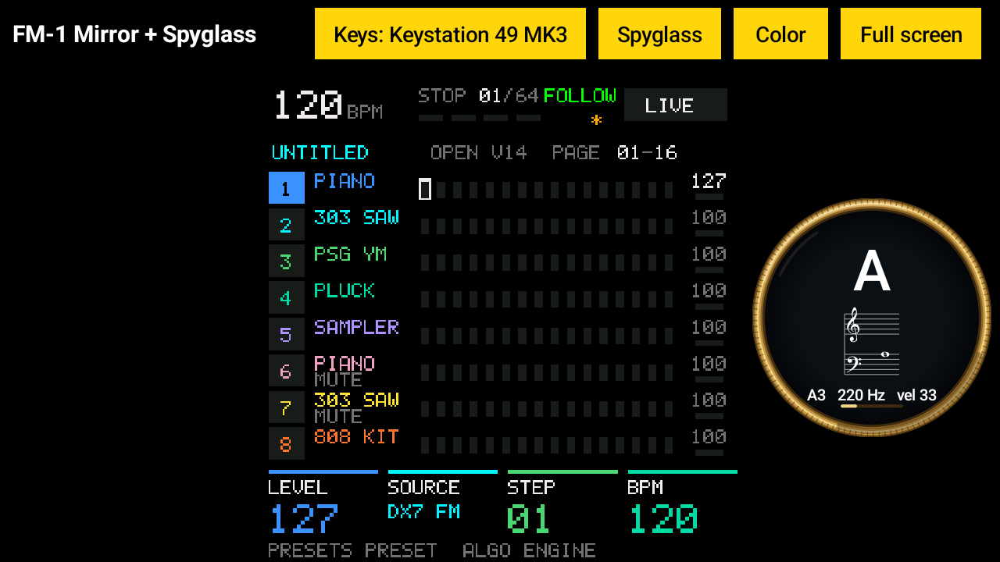

# FM-1 Mirror + Spyglass for Android

The M-VAVE FM-1's tiny 1.54-inch screen, **big on an Android tablet or phone**, live, over USB or
**Bluetooth**. Play the FM-1 from a USB keyboard through the same app, and watch every note or chord
you play, on the keyboard or on the FM-1's own keys, in a **spyglass** beside the screen.



It combines two free apps for Android: [FM-1 Mirror](https://github.com/pfkellogg/fm1-mirror) (the
big screen) and [Synth Spyglass](https://github.com/pfkellogg/synth-spyglass-android) (the notes). On
Android only one app at a time can play the FM-1, so the two can't run together; this one does both.

**Watch it:** [FM-1 Mirror + Spyglass for Android: Big Screen, MIDI Bridge & Note Spyglass, All in One](https://youtu.be/XDqrabQf5uY) (2:03)

Questions, or something not working? Write to me: **pfkellogg@gmail.com**

## Download

[**FM-1-Mirror-Spyglass-android.apk**](https://github.com/pfkellogg/fm1-mirror-spyglass-android/releases/latest/download/FM-1-Mirror-Spyglass-android.apk)
(Android 11 or newer)

Open the link on the tablet or phone and tap the file when it has downloaded. It isn't from Google
Play, so Android asks first: allow your browser to **install unknown apps**, then tap **Install**.

> **Not the green "Code" button.** GitHub's green **Code → Download ZIP** gives the app's source
> code, which doesn't install. Use the link above, or **Releases** on the right of the page.

Already have FM-1 Mirror for Android? This installs over it, as an update.

## Plugging it in

The tablet's USB-C port takes a small **USB hub** (one with its own power input is best, so the tablet
charges too). Into the hub:

- the **M-VAVE FM-1**, with its USB cable
- the **keyboard** (any USB MIDI keyboard), or a USB MIDI interface whose MIDI IN comes from another
  instrument or a sequencer

The FM-1's sound still comes out of its own headphone jack, as always. If the hub has a power input,
plug the hub into the tablet first and its power in after: the tablet may otherwise only charge from it
and not see what's plugged in.

## The FM-1's screen: one-time setup

The FM-1 doesn't normally send its screen anywhere, so it needs the **FM-1 Big Screen** firmware: M-VAVE's
free Official Open firmware plus one small addition that sends the screen over the USB cable. Open the
app with the FM-1 plugged in and it tells you which firmware the FM-1 has and what to do. With the
firmware it came with, it's two steps:

1. **M-VAVE's Official Open firmware**, from M-VAVE's
   [FM1 Workbench](https://open.m-vave.com/fm1-workbench) page in Chrome (a computer is easiest):
   **Device update › Recovery & force update**, tick **Force flash**, **Connect device**, tick
   **I have backed up…**, **Force flash**. This replaces the FM-1's sounds with M-VAVE's: if you made
   your own, save them first on the page's **Projects & sounds** tab.
2. Plug the FM-1 back into the tablet: the app offers **Install Big Screen** (about 2 minutes). Keep the
   FM-1 plugged in and on until it's done.

**Coming from M-VAVE's V16:** the FM-1 keeps V16's updater, which names itself `ota-FM-1_016`. This app finds it
from 1.4.0; **older versions looked only for V15's updater**, said the connection was lost partway through the
install, and left the FM-1 waiting in its updater (M-Upgrade or M-VAVE's page finishes it). With an older version,
put the original V15 back first (**Recovery & force update › Restore original V15**). Thanks to a viewer who
reported it.

Tested with FM-1 Mirror 1.3.0 on a Mac, on a real FM-1 that had been on V16 (2026-11-04): V16, then Official Open, then Big Screen, with no lost connection. Not yet tested from V16 on Android. Installing Big Screen replaces V16. [The results](https://github.com/pfkellogg/fm1-mirror/blob/master/docs/V16-TEST.md), and [the video](https://youtu.be/WOjvFdw5KMA).

Going back is easy: on the same page, **Device update › Start update** puts back M-VAVE's own Official
Open firmware, and **Recovery & force update › Restore original V15** the firmware it came with.

## Using it

- **The screen** fills the middle, live: turn a knob, press a button, play a note, and it changes with
  the little one. **Full screen** (tap the screen to come back), and **Color** for other looks: Bright
  color (lifts dark colours like purple so they can be read), Yellow on black, White on black, Black on
  white.
- **Keys:** the keyboard plugged in plays the FM-1 through the app. It's picked by itself; tap
  **Keys** to choose another device (a sequencer, a MIDI interface, or another app's MIDI device such
  as Synth Spyglass's "Mac (Wi-Fi)", for a computer's keyboard over Wi-Fi) or **None**.
  - Everything is moved to **channel 1** by default, where the FM-1 listens: a keyboard knocked onto another
    channel (a Keystation came set to 13) would be silent otherwise. **Keys › Channel** picks another (1 to 16:
    e.g. 3 for [ChoralRoot's MIDI Keys](https://github.com/pfkellogg/ChoralRootFM1/blob/big-screen/BIG_SCREEN.md#playing-it-from-a-usb-keyboard),
    its chord engine from the keyboard), or **as they come**, for a sequencer playing the FM-1's tracks on their
    own channels.
  - Clock goes through too. SysEx never does: that's how the FM-1 is updated.
- **The title** names the firmware the FM-1 says it runs (**SLOOP 2.8.4**), from 1.4.1. Firmware that doesn't say, like M-VAVE's Open, keeps the usual title.
- **Hide mirror / Show mirror** hides the FM-1's screen, to keep only the spyglass. **Smooth** (on to begin with) takes the jaggies off the FM-1's text and lines; off shows exactly what the FM-1 sends.
- **Spyglass:** a round brass eyepiece beside the screen with the note or chord you play
  ("A3 220 Hz", "C major", "E + G · minor 3rd"), the notes on a grand staff, and how hard you hit the
  key. On top of it, the **sound playing** (`T1 FM6 ICE BELL`), when the firmware says it
  (since 1.4.0: [JIANT FM + Big Screen](https://github.com/pfkellogg/JIANT/blob/big-screen/BIG_SCREEN.md) does,
  others don't yet, and then there's nothing on top). Drag it to move it; pinch it, or tap it and drag the grip on its rim, to resize it; tap it and
  **✕** to put it away.
  - **The FM-1's own keys** show too, once its **KEY OUT** is on (once, it's remembered): on the FM-1,
    press **SEQ**, turn **ALGO** to page **6/8 MIDI TRACK**, and turn **K4 (KEY OUT)** to **ON**
    (**K3, OUT PORT**, on **USB+BLE**).
- **Update FM-1** shows in the bar when this app has a newer Big Screen firmware than the FM-1 runs
  (over USB only; about 2 minutes, your sounds and projects stay).
- Playing works while the app is on screen: switched to another app, it lets go of the FM-1.

## Over Bluetooth

No cable to the FM-1: it can sit across the room on its battery. It needs the Big Screen firmware
from this app's 1.3 or later (an older one sends its screen over USB only; plug it in once and tap
**Update FM-1**).

1. On the FM-1, hold **HOME** and press **GLO**: the **BLUETOOTH** page. **K1 BLUETOOTH** on **ON**,
   **K3 BLE ROLE** on **DEVICE**. It says **WAITING FOR DEVICE**.
2. Unplug the FM-1's USB cable (or never plug it in). The app says **Waiting for the FM-1…**: tap
   **Find the FM-1 over Bluetooth**, and **Allow** Nearby devices. It finds **FM1 Community_BLE**,
   connects, and the title says **Bluetooth**.
3. From then on it connects by itself whenever the FM-1 isn't plugged in. Plug it in, and the app moves
   to USB (faster); firmware is only ever installed over USB.

The FM-1 takes one Bluetooth connection at a time: close this app before connecting a computer
([FM-1 Mirror](https://github.com/pfkellogg/fm1-mirror) on a Mac works over Bluetooth too), and the
other way round.

## If there's no sound

- **The keyboard's volume slider** (a Keystation has one) sets the FM-1's volume. Slid down, the FM-1
  plays silently; turning the FM-1's preset knob loads the preset's own volume, which is why that seems
  to fix it. Keep the slider up.
- **Close Synth Spyglass and MIDI Bridge.** If one of them is on, it holds the FM-1 and this app shows
  "Waiting for the FM-1…".
- **The FM-1's volume and headphone cable**, as always.

## Build it yourself

Java 17 and the Android SDK:

```
./gradlew assembleDebug
# -> app/build/outputs/apk/debug/app-debug.apk
```

`test/run.sh` checks the screen and updater messages on a computer, no tablet needed. Debug builds
include a pretend FM-1 ("FM1 Simulator") for trying the app without one.

## Other firmwares: ChoralRoot, JIANT FM and Skiff

The screen messages work with any FM-1 firmware that sends them (the screen part is MIT). The first community firmware
with it: **ChoralRoot + FM-1 Big Screen** ([pfkellogg/ChoralRootFM1](https://github.com/pfkellogg/ChoralRootFM1/blob/big-screen/BIG_SCREEN.md)),
Quixotic7's chord instrument with 32 lines added. Over USB; "Update FM-1" doesn't show on it (it would replace it).

The second: **JIANT FM + FM-1 Big Screen** ([pfkellogg/JIANT](https://github.com/pfkellogg/JIANT/blob/big-screen/BIG_SCREEN.md)),
juanjiant's music system (synths, drums, a sequencer, songs), V10.49 with 38 lines added. Also over USB only, and
"Update FM-1" doesn't show on it either. JIANT has daily builds; ours stays at V10.49 until the screen is added to a newer one. Watch it: [JIANT FM on a Big Screen](https://youtu.be/7o5s0EDJX5c).
JIANT also says which sound is playing, shown on top of the spyglass, and the app finds it by its own USB name,
"JIANT" (both since 1.4.0; earlier versions kept waiting for the FM-1).

The third: **Skiff + FM-1 Big Screen** ([pfkellogg/skiff](https://github.com/pfkellogg/skiff/blob/big-screen/BIG_SCREEN.md)),
illuminus5's six-track groovebox, Skiff 2.1.1 with about 37 lines added, and the sound playing on the spyglass too. USB only.
All three come from Leo Kuroshita's Felucca, and so do 23 of the 25 most popular FM-1 firmwares
([FIRMWARE_FAMILY.md](https://github.com/pfkellogg/skiff/blob/big-screen/FIRMWARE_FAMILY.md)). Watch it: [Skiff on a Big Screen + the FM-1 Firmware Family Tree](https://youtu.be/lmMT-FtAoSE).

The fourth: **SLOOP + FM-1 Big Screen**, isod89's live groovebox and the most starred FM-1 firmware, SLOOP 2.8.4 with about 40 lines added, and the sound playing on the spyglass too. Tested on a real FM-1 (2026-11-04) with FM-1 Mirror on a Mac, but **not released yet**. Watch it: [SLOOP on a Big Screen](https://youtu.be/Pd4Bm6JvtkU).

With Keys on SLOOP, a keyboard plays track 1 only: FM-1 Mirror on a Mac sends it on channel 1, while the FM-1's own keys play the selected track. Tested 2026-11-04: on track 1 both play the same sound. To have the keyboard follow the selected track, SLOOP's manual gives GLO > MIDI 2 > IN = CH 1 (not tested yet). Tested with FM-1 Mirror on a Mac.

## For the curious

Plain Java, Android's own MIDI, no other libraries.

- `Codec.java`: the screen messages. The app sends `F0 7D 'F' 'S' 00 F7` about once a second (`01` to
  have the whole screen sent again); the FM-1 sends each row it paints as
  `F0 7D 'F' 'S' 01 row col <runs> F7`, each run a count and an RGB565 colour. Firmware that knows it
  also sends the sound playing, `F0 7D 'F' 'S' 02 <name> F7` (ASCII), after each hello and when it changes.
  Also M-VAVE's updater messages.
- `Installer.java`: the Big Screen installer, a port of M-VAVE's own web updater.
- `Keys.java`: the keyboard, passed on to the FM-1. `Played.java`: what's played (the keyboard and the
  FM-1's own keys), for the spyglass. `Ble.java`: the FM-1 over Bluetooth MIDI.
- `Glass.java`: the spyglass. `StaffView.java`, `Chord.java`, `NoteNames.java`: the staff, the chord
  names and note names, from Synth Spyglass for Android.
- `firmware/`: the Big Screen firmware package the app installs, built from
  [pfkellogg/fm1_open, branch `screen-out`](https://github.com/pfkellogg/fm1_open/tree/screen-out).
  Its screen part is MIT licensed, so any FM-1 firmware can use it.

## License

GPL-3.0 (see LICENSE), like M-VAVE's FM1 Open application code it builds on. © 2026 Patrick F.
Kellogg. M-VAVE and FM-1 are M-VAVE's names; this app isn't an M-VAVE product.
